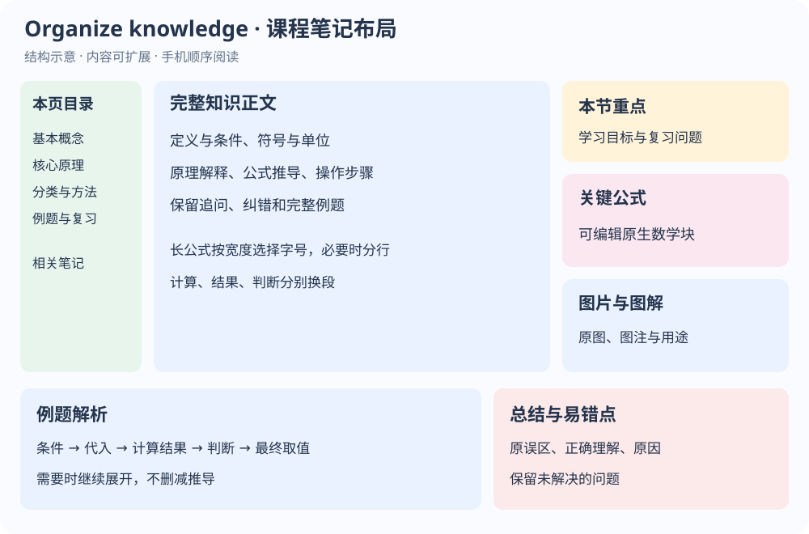

# Organize knowledge

把学习聊天整理为完整的 **Notion 课程笔记**和适合关联的 **Obsidian Markdown**。

Organize knowledge 是一套可重复使用的 Skills 和插件源码。它从当前实际可读取的聊天中提取概念、公式、推导、例题、操作步骤、追问和纠错，按课程归类；同时处理可访问的用户图片和助手配图，并为手机阅读整理公式字号和计算段落。

**当前版本：0.2.0 · MIT 开源许可 · 以中文学习笔记为主。**

## 能做什么

- **所有科目完整学习档案**：保留概念、条件、完整推导、逐步计算及原因，按真实学习日期与详细专题组织。
- **原始对话全文保留**：所选范围内用户消息、助手可见回答及连续追问按顺序完整保存；专题重组不能精简原文。
- **历史缺口与补传**：列出能核实的缺失对话范围；收到补传后与旧笔记比较，补齐原文与知识，验证后报告哪些缺口已解决。无法确定缺失位置时明确说明，不编造。
- **重复内容跳过**：Notion 与 GitHub 分别读取旧内容，完全相同且已完整保存时不创建、不更新、不重复传图，补传重叠与同批次重复也跳过；部分重复只补新增知识、原文或缺失媒体。仅一边已有时补齐另一边。
- **保存 Notion 笔记**：在使用者指定的课程位置创建笔记，包含目录、重点、公式、例题、易错点和复习问题。
- **归档图片**：处理可读取的用户图片、助手生成图、实物配图及图片卡片；执行上传、插入、回读核对，并单独报告缺图。
- **归档交互图表**：取得真实 HTML/数据后，优先上传为 Notion 原生 HTML embed，保留原有控件并备份源文件；截图不能替代交互源，保存与交互实测分别报告。
- **手机公式排版**：估算公式宽度，选择合适字号；长式必要时分行；代入、结果、判断与最终取值分别成块。
- **导出 Obsidian Markdown**：按概念独立组织，提供建议文件名、别名、标签和候选关联，直接在聊天中输出以便复制。
- **保存至 GitHub 私有仓库**：配置自己的仓库后逐篇去重，保留 YAML、公式与 `related_candidates`；重复跳过，有新增的同名文件另取名称，每篇返回真实结果。
- **按课程和领域归类**：识别每篇笔记内容，优先沿用 Notion 课程，同课笔记放在同一个 GitHub 目录；复用已有领域，新方面自动新建领域分类。

## 三个 Skills

- `study-chat-notes`：完整流程，一次交付 Notion 与 Obsidian 两种笔记。
- `notion-course-notes`：只整理并保存 Notion 课程学术笔记。
- `obsidian-concept-notes`：输出可复制的 Obsidian 概念笔记，可保存至已授权的私有 GitHub，默认由使用者的插件生成双向链接。

这三个 Skill 之间共享参考资源，安装时请保留完整的 `skills/` 目录。

正常调用 `study-chat-notes` 默认同时保存 Notion 和已配置的 GitHub 私有仓库，并照常提供可复制的 Obsidian Markdown。只有明确说“只存 Notion”“只传 GitHub”“只导出”或限定知识点时才选择性执行。限定知识点不会自动取消某个保存目标；独立点名另外两个 Skill 则执行其单项功能。

## 安装与使用

这是 **Skills 插件源码**，不包含作者的账号连接或 Notion 凭据。公开 GitHub 仓库不会自动将插件发布到 ChatGPT 公共插件目录。

### 在支持仓库插件来源的 Codex / ChatGPT 桌面环境中

使用支持此命令的 Codex CLI 添加来源：

```sh
codex plugin marketplace add automan2006/organize-knowledge
```

然后在支持本地／仓库来源的 ChatGPT 桌面插件界面选择 **Organize knowledge** 来源，安装或启用插件。不同版本的入口和权限可能不同，参见 [OpenAI 官方插件打包与仓库来源说明](https://developers.openai.com/plugins/build/plugins)。安装后开启新对话，让宿主加载新 Skills。

也可下载 [Releases](https://github.com/automan2006/organize-knowledge/releases) 中的插件 ZIP，在支持插件导入的环境中导入；或者让支持 Skills 的代理安装 `plugins/organize-knowledge/skills/` 中的三个 Skill。

### 第一次使用前

1. **连接自己的 Notion**：通过宿主提供的 Notion 连接完成授权。运行时必须实际提供读取、创建和更新页面的工具；图片自动归档还需要可用的图片上传能力。
2. **指定自己的归档位置**：把课程页面或课程数据库链接提供给代理。首次使用不会默认选作者的课程库，也不会任意选择搜索到的页面。
3. **确认时区和保存意图**：明确说“保存到 Notion”后执行归档；只说预览时不写入。
4. **在原学习聊天中调用**：这样更容易取得原始消息和图片。若历史被压缩或附件失效，补充导出的聊天或原图。
5. **配置 GitHub 归档**：连接自己的 GitHub，指定一个有写入权限的私有笔记仓库并授权。正常整理同时保存两处；如果只需 Notion，可明确说“只存 Notion”。未配置时会继续其他可执行部分，并说明 GitHub 尚未完成。

可以复制以下提示，替换括号中的内容：

```text
使用 $study-chat-notes 整理当前整条学习聊天。

我的 Notion 课程位置：[粘贴自己的课程页面或数据库链接]
我的时区：[例如 Asia/Shanghai]

保留完整解释、公式推导、例题步骤及追问纠错。
把我发的图片和你输出的配图保存到对应知识点附近。
公式按手机可读宽度选择字号，计算结束后的解释另起一段。
保存到 Notion 后回读检查，再输出可复制的 Obsidian 概念笔记。
请分别报告用户图片和助手配图的成功数量、缺图及原因。
```

只导出 Obsidian 时：

```text
使用 $obsidian-concept-notes 整理当前聊天。
按概念分别输出可复制的 Markdown，附文件名、别名和候选关联。
```

同时保存到自己的 GitHub 私有仓库时：

```text
调用 Organize knowledge 整理当前学习聊天。
保留原有 Notion 归档流程，并将每一篇 Obsidian Markdown
保存到我的 GitHub 私有仓库 [owner/private-notes]。
保留 YAML、公式和 related_candidates，不得覆盖同名笔记。
返回每个文件路径、实际提交 SHA 和回读结果；无法上传时明确说明。
```

优先沿用 Notion 实际课程，以课程页面 ID 和仓库中已保存的分类信息匹配目录。课程笔记默认放在 `课程/<课程名>/<概念名>.md`；不属于现有课程的内容，复用或新建 `领域/<领域名>/<概念名>.md`。同课的目录、概念、方法和例题统一归类，跨课程逐篇判定；查询失败时先标待核实，不把失败当作新领域。先逐目标比较实际旧内容：完整重复时跳过，不能通过日期或后缀制造副本；有新增的同名笔记才另取后缀，不覆盖、删除或强推。分别报告新增、重复跳过和失败；只在一边已有时补齐另一边。GitHub 保存不代表本地 Obsidian 已拉取或已生成双向链接。

## 补传历史与避免重复保存

正式归档保留完整原文。Notion 按“课程 → 真实学习日期目录 → 详细专题”组织，Obsidian 按“学习记录＋概念笔记”组织；日期未知时标待核实，不用归档日期推断历史。

发现无法访问的原文时，返回能核实的标题、日期、前后文和缺口编号。你可以提供聊天导出、TXT、Markdown、JSON，或粘贴原文，然后说：

```text
这是缺失的历史聊天，请与已有笔记比较并补齐。
保留完整原文，只补缺失部分，重复内容不要再保存。
```

已完整存在的同一段原文、图片和交互源只保存一份，引用实际归档位置。不同的追问、不同答案和缺失推导不能被相同主题去重掉。不会自动删除旧重复笔记。仅比较、不上传时请明确说明。

原文不可访问时不能保证恢复完整历史，也不能保证知道具体缺失哪段；如果缺少定位依据，会直接说明。文件解析、源代码取得、远端保存与手机交互测试分别核实，不把插件更新成功当作学习档案实测成功。

## Notion 笔记布局



上图是代码绘制的结构示意，不是实际页面截图。桌面布局包括左侧目录、中间正文、右侧重点／公式／图解；例题和易错点安排在下方。手机由 Notion 纵向排列。

重点使用浅色提示框；公式是可编辑的原生数学块。长式不强制大字号，也不把全部计算变成图片。

## 图片与客户端边界

- Skills 只提供工作流，不赋予读取全部聊天、读取手机相册或使用 Notion 的额外权限。
- **看得见图片不等于取得原文件。** 只有当前环境能读取原文件或可访问的图片地址时，才能自动上传。仅有手机截图时可保存截图，但不会把截图里的四个格子算作四张原图已保存。
- Notion 连接可能只提供文字页面工具。若缺少 `create_file_upload` / `create_attachment` 或等效能力，图片自动归档需要更完整的连接，不能靠本插件自行绕过。
- 随包的 JPEG/PNG 上传程序需要 Python 3.9+、原文件和 HTTPS 网络访问；SVG 在提供对应附件工具的环境中可走文本附件路径。
- iPhone、Windows 和网页端取决于账号、宿主插件支持和文件传输能力。本仓库没有对所有端做完整实测。
- 历史被截断、附件过期或图片无法读取时，明确标为“部分完成”并列出待补项。
- 公式宽度工具是保守估算，不会实时读取手机屏幕或在保存后实时缩放字号。

## 随包工具与验证

- `prepare_notion_html.py`：准备现有 HTML 的上传参数，保留原文、计算哈希并列出依赖线索；不执行 JS，不把准备成功当作上传或手机交互验证成功。
- `upload_notion_image.py`：使用 Notion 工具返回的上传响应发送真实图片文件；拒绝非预期域名和跳转，不在输出中打印授权头。
- `fit_notion_equation.py`：估算 LaTeX 排版宽度并选择字号，不修改数学内容；超长或未知结构要求拆分／复核。
- `archive_github_notes.py`：通过已认证 `gh api` 读取分类目录进行保守指纹去重；重复不写入，新内容才创建并验证提交，拒绝公开仓库且不打印凭据。语义改写由代理根据实际旧内容判断。无终端时可使用宿主 GitHub 连接器完成同样流程。

四个程序只使用 Python 标准库；GitHub 程序另需已认证的 GitHub CLI。仓库内的测试不需要真实账号或网络，也不会向笔记仓库写测试文件：

```sh
python -m unittest discover -s tests -v
python scripts/validate_public_package.py
```

开发阶段已在 Windows 环境验证 JPEG、SVG 上传与 Notion 图片块回读，并做过 37 个公式的窄宽度浏览器模拟。本公开仓库的独立测试不操作作者的私人页面；真实 iPhone 的 Notion 显示尚未完整实测。

Notion 的 [HTML blocks](https://developers.notion.com/reference/block#html-blocks) 支持在沙箱中交互呈现上传的 HTML。当前连接器可用时走原生 `<embed>`，无需公开网站。只有实际取得源码和依赖才能保留或迁移功能；仅凭截图无法提取原程序。源码回读、Notion 块回读与实际点击/拖动/参数修改是不同验证层级，不能混称全部通过。Markdown 的 HTML 链接也不会自动在 Obsidian 中执行 JavaScript。

## 数据与开源

公开版不包含作者的 Notion 页面／数据库 ID、私人笔记仓库配置、账号绑定、个人邮箱、聊天记录、原始截图或上传授权。使用者自行配置自己的账号和位置。处理学习材料时，实际数据流由所选 AI 宿主、Notion 连接及使用者指定的 GitHub 私有仓库决定；本仓库没有独立托管服务或遥测服务。

问题和建议可提交到 [Issues](https://github.com/automan2006/organize-knowledge/issues)。代码与原创资源使用 [MIT License](LICENSE)，欢迎使用、修改和贡献。


## 0.2.0：图片、PDF 与阅读资料

支持调用宿主视觉/PDF 能力读取材料，区分本学期课堂、课外知识、读书笔记；书籍聊天归入同一本书。只有阅读聊天允许凝练，课堂和知识完整保留。Notion 沿用课程库并按需建立私人学习资料库；GitHub 按三类目录归档。原件按哈希去重，两端分别验证。PDF 文字提取可选安装 pypdf；扫描件需宿主视觉/OCR，工具不可用时报告未完成。原件 GitHub 辅助脚本上限 900000 字节，Notion 单段辅助脚本上限 20 MiB，超限不声称上传。需要使用者自己的连接与私有笔记仓库。


## 0.2.1：主页笔记链接

每篇 Notion 笔记成功保存后，自动在所属课程、知识领域或书籍主页底部添加标题链接，并按真实页面 ID 去重、回读验证。保留已有内容，导航失败单独报告；不自动补写历史笔记链接。


## 0.2.2：默认保存可视化卡片

正式归档默认包含静态 HTML 卡片、图解及交互面板的源文件、实际数据和交互逻辑，保存到 Notion 与 GitHub 私库。独立文件逐项验证，以整个资源包内容去重；只有截图时明确缺源码，源已保存也不冒称交互或手机运行已实测。
